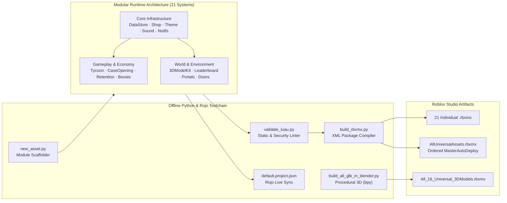
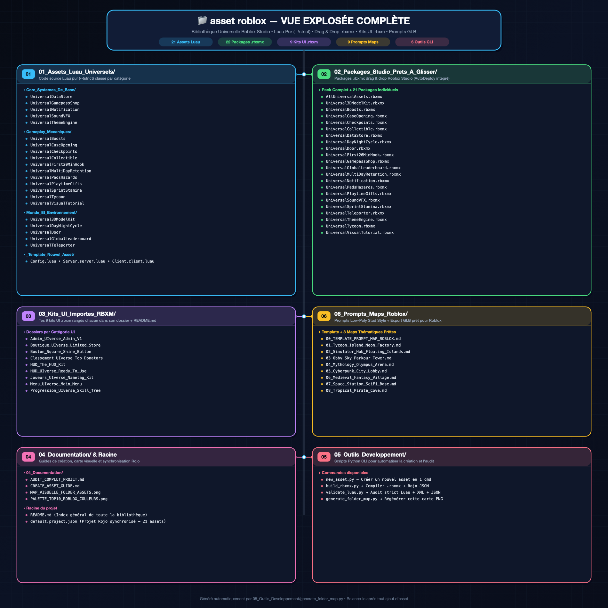
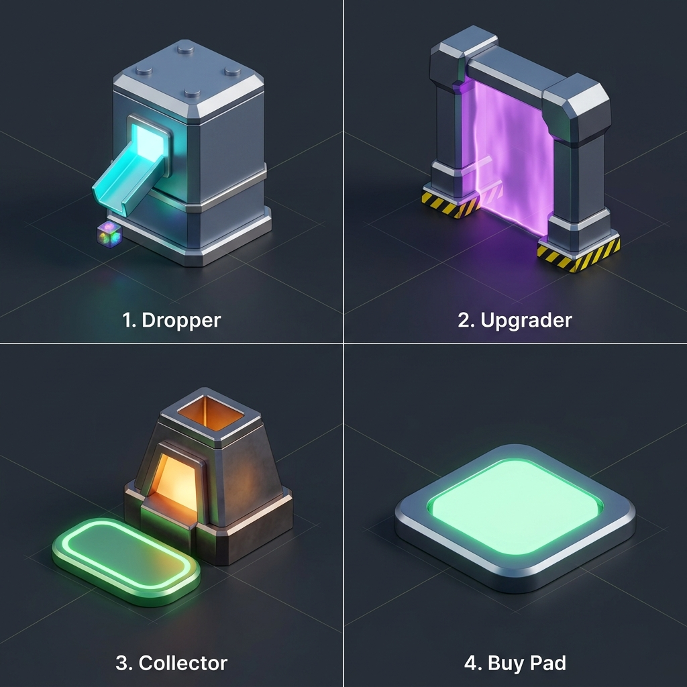
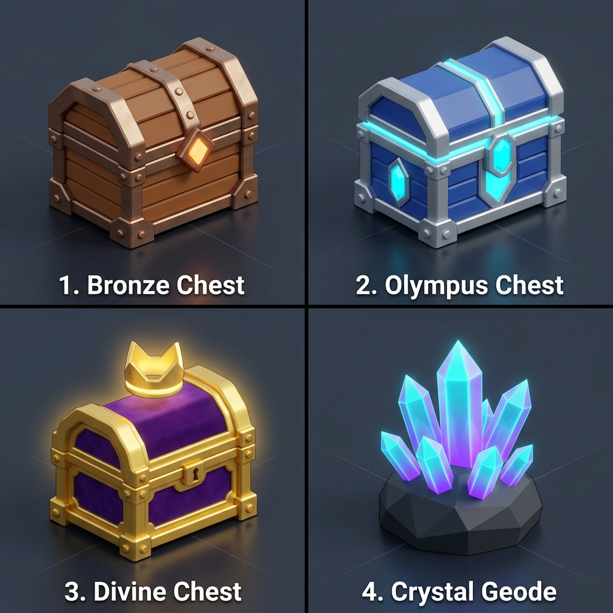
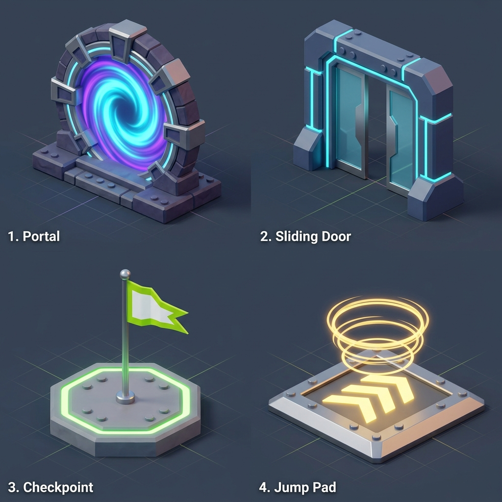
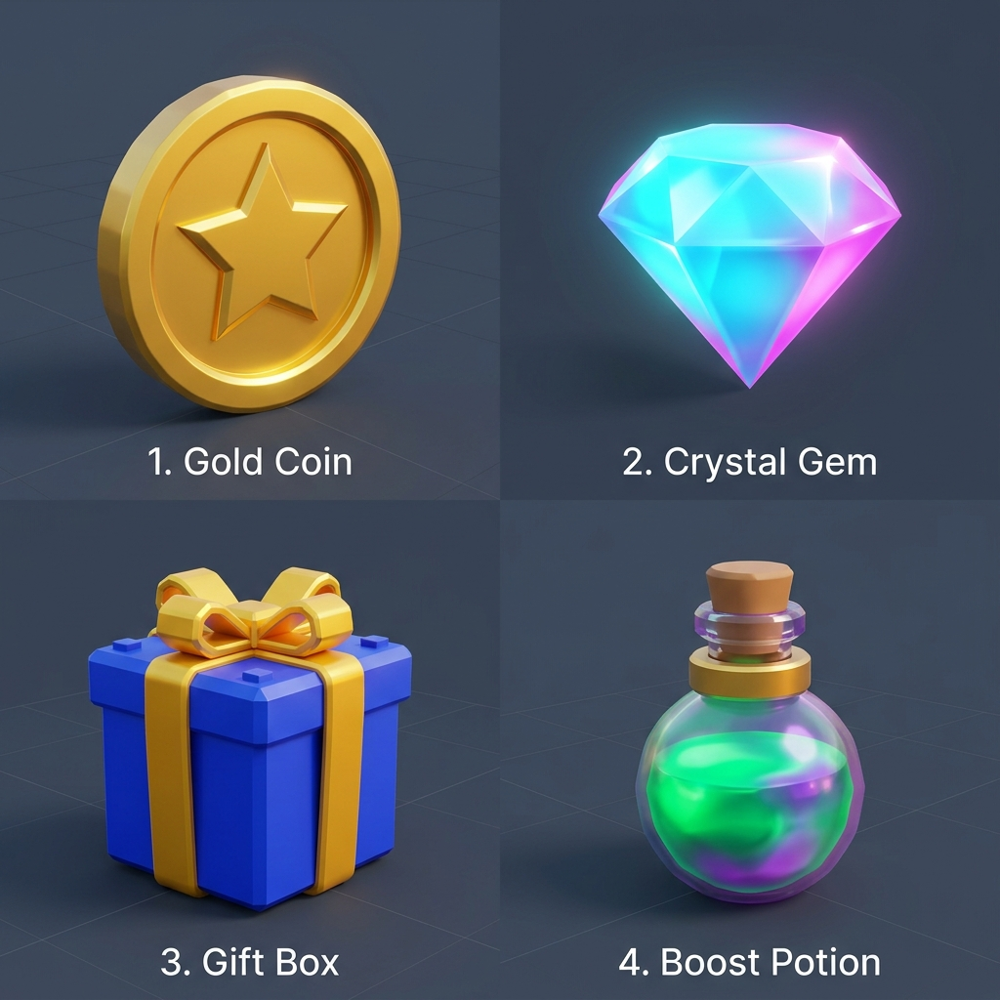
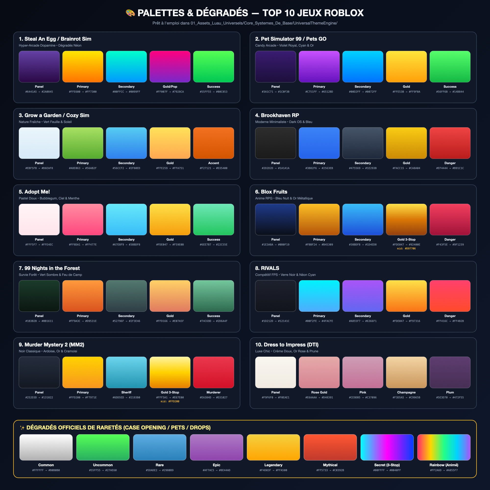

<div align="center">

# Roblox Universal Framework — Architecture Showcase

**A modular, strictly-typed systems architecture, automated Python build pipeline, and procedural 3D asset toolchain for Roblox Studio.**

[](docs/ARCHITECTURE.md)
[](docs/PROJECT_STRUCTURE.md)
[](#python-automation--quality-assurance-pipeline)
[](#intellectual-property--access)

</div>

---

> **Portfolio & Architecture Showcase**
> This public repository presents the **system architecture, repository structure, engineering standards, Python automation pipeline, and visual outputs** of the framework. The production source code (`.luau`, `.py`, `.rbxmx`, `.rbxm`) is maintained in a private repository (`c737lo-stack/asset-roblox`).

---

## Executive Summary

**Roblox Universal Framework** is a production-grade library designed to eliminate repetitive boilerplate across multiplayer projects by standardizing **core infrastructure, economy & retention mechanics, world interaction systems, automated packaging, and 3D asset generation**.

### Key Metrics

| Metric | Count | Details |
| :--- | :---: | :--- |
| **Universal Luau Modules** | **21** | 5 Core Infrastructure · 11 Gameplay & Economy · 5 World & Environment |
| **Strictly-Typed Scripts** | **67** | 100% `--!strict` Luau, zero deprecated APIs, automated static audit |
| **Studio Packages (`.rbxmx`)** | **27** | Individual drag-and-drop modules + unified `AllUniversalAssets.rbxmx` bundle |
| **Python Automation Scripts** | **7** | Scaffolding, XML/RBXMX compiler, static security auditor, chart generators, Blender `bpy` |
| **Procedural 3D Models** | **16** | 4 themed low-poly packs with automated Studio packaging & visual previews |
| **UI Kits & Map Blueprints** | **18** | 9 cataloged `.rbxm` UI kits + 8 map generation prompts & template |

---

## System Architecture

The framework enforces a strict separation between **Authoritative Server Logic**, **Declarative Configuration**, **Responsive Client UI**, and an **Offline Python Build & Audit Toolchain** synchronized via **Rojo**.



For a detailed technical breakdown of persistence fault-tolerance, server-authoritative rate-limiting, ordered deployment, and economy modeling, see **[docs/ARCHITECTURE.md](docs/ARCHITECTURE.md)**.

---

## Project Directory Blueprint

The private repository (`164` files across `7` numbered layers) follows a deterministic layout designed for instant navigation and automated tooling:

```text
asset-roblox/
├── 01_Assets_Luau_Universels/            # Pure --!strict Luau source code (21 modules, 67 scripts)
│   ├── Core_Systemes_De_Base/            #   5 core systems (DataStore, Shop, Notifs, SoundVFX, ThemeEngine)
│   ├── Gameplay_Mecaniques/              #   11 gameplay, economy & retention systems
│   └── Monde_Et_Environnement/           #   5 world, leaderboard & 3D factory systems
├── 02_Packages_Studio_Prets_A_Glisser/   # Auto-compiled .rbxmx Studio packages (27 files)
│   ├── AllUniversalAssets.rbxmx          #   Master bundle with phased MasterAutoDeploy
│   └── Modeles_3D/                       #   Pre-tagged 3D model packs (.rbxmx)
├── 03_Kits_UI_Importes_RBXM/             # 9 cataloged UI kits (.rbxm) with documentation sheets
├── 04_Documentation/                     # Architecture guides, sprint audit, visual maps & palettes
├── 05_Outils_Developpement/              # 6 Python CLI tools (scaffold, build, audit, visualizers)
├── 06_Prompts_Maps_Roblox/               # 8 structured Low-Poly map blueprints + template
├── 07_Modeles_3D_Blender/                # 16 validated 3D models, Blender bpy builder & previews
├── .github/workflows/                    # Automated CI running validate_luau.py on push/PR
└── default.project.json                  # Auto-generated Rojo project mapping
```

See the full annotated file tree in **[docs/PROJECT_STRUCTURE.md](docs/PROJECT_STRUCTURE.md)**.

### Visual Repository Map

<p align="center">
  
</p>

---

## Module Catalog

### 1. Core Infrastructure (`Core_Systemes_De_Base/`)

| Module | Responsibility & Key Engineering Features |
| :--- | :--- |
| **UniversalDataStore** | Fault-tolerant player persistence using `UpdateAsync`, retry backoff, `canSaveFlags` corruption protection, 120s autosave, and `BindToClose` flush. |
| **UniversalGamepassShop** | `MarketplaceService` monetization layer with cached Gamepass ownership, DataStore-backed idempotent `ProcessReceipt`, and responsive Shop UI. |
| **UniversalNotification** | Server-to-client animated toast notification system with 4 visual styles and PC/Mobile scaling. |
| **UniversalSoundVFX** | Curated database of 28 VFX/UI/Economy/Combat/BGM sounds with 2D/3D `SoundPlayer`, pitch randomization, BGM crossfade, and 0ms preloading. |
| **UniversalThemeEngine** | Color & gradient engine modeled on Top 10 Roblox experiences, 8 rarity tiers, and animated Rainbow shaders. |

### 2. Gameplay, Economy & Retention (`Gameplay_Mecaniques/`)

| Module | Responsibility & Key Engineering Features |
| :--- | :--- |
| **UniversalTycoon** | Multi-plot Tycoon engine (Droppers, Conveyors, Upgraders, Collector, Rebirth) driven by a mathematical `ProgressionCurve` model. |
| **UniversalCaseOpening** | 24-slot roulette system with 3D `ViewportFrame` previews, 3 crates, 6 mutations, Luck multipliers, drop odds, inventory, and resale. |
| **UniversalFirst20MinHook** | Early-session retention engine (0–20 min): 3 progressive boost phases (`x3.0 Luck`, `x2.5 Cash`) and scripted milestone moments. |
| **UniversalMultiDayRetention** | Long-term retention engine: 7-day UTC calendar, daily freshness bonus, and offline income calculation. |
| **UniversalPlaytimeGifts** | Server-validated 6-tier playtime reward grid (1m → 60m) integrated with Boosts and free Crates. |
| **UniversalBoosts** | Timed potion/multiplier system (`x2 Cash`, `x2 Luck`, `x1.5 Speed`) with server timers, persistence, and HUD bar. |
| **UniversalVisualTutorial** | Zero-text, 100% visual onboarding using 3D `Beam` paths, `Highlight`, animated arrows, and skip controls. |
| **UniversalSprintStamina** | Server-validated sprint (`Shift` / Mobile button), dynamic FOV, and reactive speed multiplier attributes. |
| **UniversalCheckpoints** | Tag-driven stage progression (`CollectionService`), `leaderstats.Stage`, auto-respawn, and optional persistence. |
| **UniversalCollectible** | Lag-free client-animated collectibles with authoritative server pickup and respawn timers. |
| **UniversalPadsHazards** | 4-in-1 attribute-configurable interactive pads (`KillBrick`, `BouncePad`, `SpeedPad`, `HealPad`). |

### 3. World & Environment (`Monde_Et_Environnement/`)

| Module | Responsibility & Key Engineering Features |
| :--- | :--- |
| **Universal3DModelKit** | Luau factory + 16 pre-tagged 3D models ready for runtime spawning or Studio placement. |
| **UniversalGlobalLeaderboard** | 3D Top-10 `OrderedDataStore` + `SurfaceGui` leaderboard with username caching and 60s refresh cycles. |
| **UniversalTeleporter** | Named portal routing (`PortalId` → `TargetId`), fade transitions, and server cooldowns. |
| **UniversalDoor** | `TweenService` sliding doors supporting `ProximityPrompt`, touch triggers, and key/attribute locks. |
| **UniversalDayNightCycle** | Smooth lighting cycle with server API (`SetTime`, `Pause`, `Resume`) and `Lighting.UniversalPeriod` attribute. |

---

## Python Automation & Quality Assurance Pipeline

A dedicated suite of **7 Python scripts** automates scaffolding, compilation, static security analysis, visual documentation, and 3D asset generation:

| Script | Role |
| :--- | :--- |
| `new_asset.py` | Scaffolds a standardized module (`Config.luau`, `Server.server.luau`, `Client.client.luau`, `README.md`) with `--!strict` headers. |
| `build_rbxmx.py` | Compiles all 21 Luau modules into valid Roblox XML (`.rbxmx`), generates `AllUniversalAssets.rbxmx` with phased `MasterAutoDeploy`, and updates `default.project.json`. |
| `build_3d_models_rbxmx.py` | Packages the 16 procedural 3D models into pre-tagged `.rbxmx` bundles. |
| `validate_luau.py` | Automated CI auditor verifying `--!strict`, absence of deprecated calls (`wait`/`spawn`/`delay`), delimiter balance, `OnServerEvent` rate-limiting & `PlayerRemoving` cleanup, XML `Disabled=true` safety flags, and Rojo JSON validity. |
| `generate_folder_map.py` | Programmatically renders the visual repository architecture map (`PNG`). |
| `generate_palette_chart.py` | Generates the Top 10 Roblox UI color palette reference sheet (`PNG`). |
| `build_all_glb_in_blender.py` | Headless Blender (`bpy`) script generating the 4 procedural low-poly 3D asset packs. |

---

## Visual Previews

### Procedural 3D Asset Packs (16 Models)

| Tycoon Pack | Case Opening Pack |
| :---: | :---: |
|  |  |

| World & Portals Pack | Collectibles Pack |
| :---: | :---: |
|  |  |

### Top 10 Theme Palette Reference (`UniversalThemeEngine`)

<p align="center">
  
</p>

---

## Intellectual Property & Access

All source code, compiled `.rbxmx` / `.rbxm` packages, and Blender scripts are **proprietary and hosted in a private repository**. This repository serves strictly as a technical portfolio and architecture overview.

For technical inquiries or collaboration, connect via **[GitHub](https://github.com/c737lo-stack)**.
